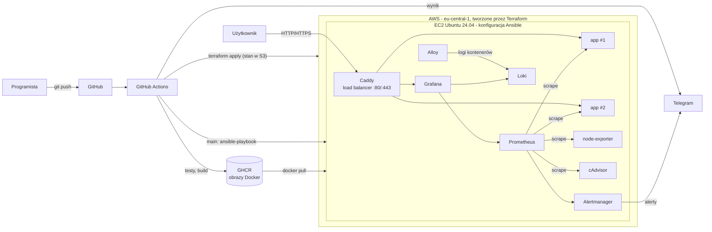
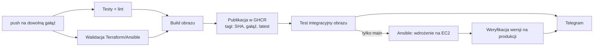

# Projekt dyplomowy DevOps

Kompletny, zautomatyzowany cykl życia aplikacji webowej: od commita, przez testy, budowanie i publikację obrazu,
po automatyczne wdrożenie na AWS, z monitoringiem, centralnymi logami i powiadomieniami na Telegram.

| Obszar | Narzędzia |
|---|---|
| Aplikacja | Python 3.13, Flask, Gunicorn, metryki Prometheus |
| Konteneryzacja | Docker (obraz wieloetapowy), Docker Compose |
| Infrastruktura jako kod | Terraform (AWS: VPC, EC2, Elastic IP, Security Group, Budżet) + Ansible |
| CI/CD | GitHub Actions, GitHub Container Registry (GHCR) |
| Load balancing i TLS | Caddy (round robin na 2 repliki, opcjonalnie automatyczny certyfikat Let's Encrypt) |
| Monitoring | Prometheus, Alertmanager, Grafana, node-exporter, cAdvisor |
| Logi | Grafana Loki + Grafana Alloy |
| Powiadomienia | Telegram (wynik pipeline'u i alerty z monitoringu) |

## Architektura



## Struktura repozytorium

```
app/                     aplikacja + testy + Dockerfile
deploy/                  stos uruchamiany na serwerze (docker-compose.yml) i konfiguracja monitoringu
  caddy/                 load balancer / reverse proxy
  prometheus/            scrape config + reguły alertów
  alertmanager/          (alertmanager.yml generuje Ansible - zawiera token Telegrama)
  grafana/               źródła danych i dashboardy (provisioning - zero klikania)
  loki/, alloy/          centralne logi
terraform/               infrastruktura AWS
ansible/                 konfiguracja serwera: role common (swap, pakiety), docker, stack (wdrożenie)
.github/workflows/       pipeline CI/CD
scripts/                 setup-github.sh (repo, klucz SSH), demo-traffic.sh (ruch do demo), telegram-chat-id.sh
.github/actions/         wspólne kroki: terraform-init (stan w S3), telegram
docs/                    instrukcja zakładania kont, scenariusz obrony
Makefile                 wszystkie komendy w jednym miejscu (make help)
```

## Pipeline CI/CD



* **Każda gałąź:** testy jednostkowe (pytest), lint (ruff), `terraform fmt/validate`, `ansible --syntax-check`,
  build obrazu, publikacja w GHCR, uruchomienie opublikowanego obrazu i sprawdzenie `/health`, `/api/info`, `/metrics`.
* **Gałąź `main`:** dodatkowo `ansible-playbook` wdraża obraz o tagu równym SHA commita i sprawdza,
  czy produkcja zwraca właśnie tę wersję.
* **Zawsze:** wiadomość na Telegram ze statusem każdego etapu i linkiem do przebiegu.

## Wdrożenie od zera

Wszystko, co dotyka chmury, działa w **GitHub Actions**. Klucze AWS, token Telegrama i hasła są zapisane wyłącznie
w GitHub Secrets, na komputerze nie ma żadnych kluczy, haseł ani stanu Terraformu (stan trzymany jest w S3).
Zakładanie kont i dodawanie sekretów opisuje [docs/KONFIGURACJA-KONT.md](docs/KONFIGURACJA-KONT.md).

```bash
make github   # repozytorium, klucz SSH do wdrożeń (od razu do GitHuba), kontrola sekretów
make up       # workflow "Infrastruktura": Terraform (AWS) + Ansible (serwer + aplikacja)
```

To samo bez terminala: **Actions → Infrastruktura → Run workflow → apply**.
Od tej chwili każdy push na `main` sam wdraża nową wersję.

Infrastruktura jest **idempotentna**: ponowne uruchomienie bez zmian w kodzie daje
`No changes` w Terraformie i `changed=0` w Ansible.

| Komenda | Co robi |
|---|---|
| `make github` | Przygotowuje repozytorium do CI/CD |
| `make up` | Tworzy infrastrukturę i wdraża wszystko od zera |
| `make down` | Usuwa całą infrastrukturę AWS |
| `make status` | Ostatnie przebiegi pipeline'ów |
| `make local` | Cały stos lokalnie w Dockerze (bez chmury i sekretów): http://localhost:8080 |
| `make test` / `make lint` | Testy i walidacja |

Workflowy:

| Plik | Kiedy | Co robi |
|---|---|---|
| `ci-cd.yml` | każdy push | testy, walidacja IaC, build i publikacja obrazu; na `main` także wdrożenie |
| `infra.yml` | ręcznie (`apply` / `destroy`) | Terraform + pierwsze wdrożenie albo usunięcie infrastruktury |
| `deploy.yml` | wywoływany przez oba powyższe | Ansible na serwerze i weryfikacja wersji |

## Monitoring i logi

* **Grafana:** `http://<IP>/grafana/` (login `admin`, hasło z `GRAFANA_ADMIN_PASSWORD`)
  * *Aplikacja:* liczba replik, wdrożona wersja, żądania/s na replikę (widać load balancing), kody odpowiedzi,
    opóźnienia p50/p95/p99, pamięć replik, logi aplikacji.
  * *Infrastruktura:* CPU, RAM, swap, dysk, sieć, load average, zasoby każdego kontenera, logi wszystkich kontenerów.
* **Alerty** (Prometheus, wysyłane przez Alertmanager na Telegram): niedziałająca replika, brak replik,
  ponad 5% błędów 5xx, p95 powyżej 1 s, niedziałająca usługa monitoringu, CPU powyżej 85%, RAM poniżej 10%, dysk poniżej 15%.
* **Demo alertu:** `./scripts/demo-traffic.sh http://<IP> errors` - po ok. 2 minutach przychodzi alert na Telegram,
  a po zakończeniu skryptu wiadomość o rozwiązaniu.

## Endpointy aplikacji

| Ścieżka | Opis |
|---|---|
| `/` | Strona z wersją, nazwą repliki i licznikiem odwiedzin |
| `/health` | Health check |
| `/api/info` | Wersja i replika w JSON |
| `/metrics` | Metryki Prometheusa |
| `/api/slow?seconds=N` | Celowo wolna odpowiedź (demo opóźnień) |
| `/api/error` | Celowy błąd 500 (demo alertów) |

## Bezpieczeństwo i koszty

* Sekrety wyłącznie w GitHub Secrets; żadne nie są zapisane na komputerze ani w repozytorium, a Ansible nie loguje tokenów.
* Stan Terraformu w S3 (szyfrowany, wersjonowany, z blokadą), ID konta AWS maskowane w logach.
* SSH wyłącznie kluczem, który istnieje tylko w GitHub Secrets; Prometheus i Alertmanager słuchają tylko na `127.0.0.1`.
* Dysk szyfrowany, IMDSv2, kontener aplikacji działa jako użytkownik bez uprawnień roota.
* HTTPS: ustaw zmienną repozytorium `SITE_ADDRESS` na domenę `tls_domain` z podsumowania workflow Infrastruktura (np. `3-120-45-67.sslip.io`); Caddy sam pobierze certyfikat.
* **Koszt:** t3.micro, 20 GB gp3 i publiczny adres IP mieszczą się w darmowym pakiecie AWS (Free Plan: kredyty
  dla nowych kont). `cpu_credits = "standard"` wyklucza dopłaty za CPU, a budżet AWS wysyła e-mail po przekroczeniu
  1 USD. GitHub Actions i GHCR są darmowe dla publicznych repozytoriów. Po obronie: `make down`.

## Ograniczenia i możliwe rozszerzenia

* Jeden serwer: repliki chronią przed awarią procesu, nie całej maszyny. Kolejny krok to Auto Scaling Group + ALB
  albo Kubernetes (EKS / k3s), co kosztuje więcej niż darmowy pakiet.
